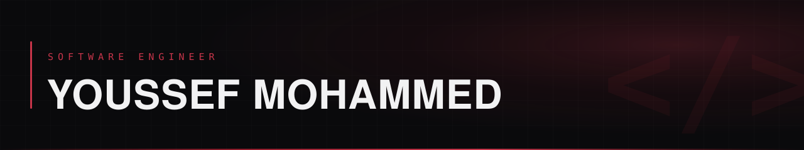
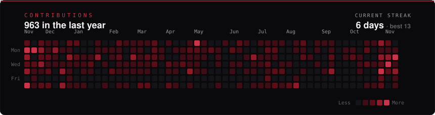

  
   
  I build SaaS products end to end — web, mobile, API, and automation.

  
  
  

## About

I am a software engineer who ships SaaS products end to end — the client, the mobile app, the API, and the automation around them.

Most of my work is on a production dental SaaS used by real clinics: frontend architecture, a shared design system, a PDF generation pipeline, and the React Native app that mirrors the web platform. Outside work I build the other side of the stack — Node services with queues, Laravel multi-tenant APIs, and agent pipelines that run locally.

I care about architecture that holds under product pressure, measurable performance, and codebases that are easier to work in six months later. Tests, type checks, and lint are gates, not suggestions.

## Focus

| Area | What I do |
| --- | --- |
| **Frontend** | React and Next.js architecture, design systems, performance work, complex state and data layers. |
| **Mobile** | React Native and Expo apps with feature parity to web — auth, realtime data, push, deep links, store releases. |
| **Backend** | Node and Laravel APIs, PostgreSQL and MongoDB models, queues, payments, typed contracts. |
| **AI & Automation** | LLM features and agent workflows with deterministic checks and human approval gates. |

## Selected Work

| Project | Scope | Stack |
| --- | --- | --- |
| **Diagnosit** · private | Dental SaaS used by clinics. Re-architected the web app, built the design system and PDF pipeline, shipped the Live Patient Link, architected the mobile app. | Next.js, React Native, TypeScript, TanStack Query |
| **AI Website Audit** · private | Full-stack SaaS: Next.js client plus an API with queued browser and Lighthouse workers, subscriptions, and quotas. | Next.js 16, Express, MongoDB, BullMQ, Playwright, Gemini |
| **[Multi-Tenant SaaS API](https://github.com/YussefMo/multi-tenant-plog-app)** | Schema-per-tenant Laravel API with a separate owner schema, billing, generated docs, and CI. | Laravel 13, PHP 8.3, PostgreSQL, Stripe, OpenAPI 3.1 |
| **Faceless Video Creator** · closed source | Local-first content pipeline: research, script, local voice, validated scene plan, two human gates. | n8n, llama.cpp, Remotion, Python, ffmpeg |
| **[Portfolio](https://github.com/YussefMo/animated-portfolio)** | Personal site and project case studies with a separate admin app. | Next.js 16, Tailwind v4, GSAP, Firebase Admin |

## Stack

| Layer | Tools |
| --- | --- |
| **Languages** | `TypeScript` `JavaScript` `PHP` `SQL` `Python` |
| **Frontend** | `React` `Next.js` `React Native` `Expo` `Tailwind CSS` `shadcn/ui` `GSAP` |
| **Backend** | `Node.js` `Express` `Laravel` `PostgreSQL` `MongoDB` `Redis` `BullMQ` |
| **AI & Automation** | `Gemini` `Vercel AI SDK` `n8n` `Playwright` `Lighthouse` |
| **Tooling** | `Git` `GitHub Actions` `Vite` `Vitest` `Vercel` `Figma` |

## Content

I break down architecture, backend decisions, and the parts of shipping that never make it into a README.

  
  
  

## GitHub

  

  Based in Menoufia, Egypt · Working remotely · Open to software engineering roles

