  

---

  
  
  
  

---

<h1 align="center">Youssef Mohammed</h1>

  

---

### 🎬 Beyond the Code

Architecture, backend decisions, and the parts of shipping that never make it into a README — on video.

  
  
  

---

### 👨‍💻 About Me

I'm a **Software Engineer** from **Egypt 🇪🇬** who ships SaaS products end to end — the client, the mobile app, the API, and the automation around them.

Most of my work is on a production dental SaaS used by real clinics: frontend architecture, a design system, a PDF generation pipeline, and the React Native app that mirrors the web platform. Outside work I build the other side of the stack — Node services with queues, Laravel multi-tenant APIs, and agent pipelines that run locally.

- 🔭 Building with **React, Next.js, React Native, Node.js, Laravel**
- 🗄️ Comfortable in the data layer: **PostgreSQL, MongoDB, Redis, BullMQ**
- 🧠 Focused on **architecture, performance, and maintainability**
- 🤖 Shipping **AI features and agent workflows** with deterministic checks
- 🧪 Treating tests, type checks, and lint as gates, not suggestions

🎯 **Current direction:** product engineering with full-stack scope — building systems where the interface, the API, and the automation are designed together.

---

### 🛠 Tech Stack

 
 
 

---

### 🚀 Selected Work

- **AI Website Audit** — full-stack SaaS. Next.js 16 client plus an Express/MongoDB API with queued Playwright + Lighthouse workers, Gemini analysis, OAuth, subscriptions, and quotas. *Private product.*
- **[Multi-Tenant SaaS API](https://github.com/YussefMo/multi-tenant-plog-app)** — Laravel 13 / PHP 8.3 / PostgreSQL. Schema-per-tenant isolation, Stripe billing, OpenAPI 3.1 docs, and CI.
- **[Portfolio](https://github.com/YussefMo/animated-portfolio)** — Next.js 16, Tailwind v4, GSAP + Lenis, Firebase Admin server actions. Live at [ymdev.me](https://ymdev.me).
- **Faceless Video Creator** — closed-source, local-first pipeline: n8n orchestration, local LLM and voice, Remotion renderer, two human approval gates.

---

### 📊 GitHub Activity

  

---

### 🟡 Contributions

<picture>
  <source media="(prefers-color-scheme: dark)" srcset="https://raw.githubusercontent.com/YussefMo/YussefMo/output/pacman-contribution-graph-dark.svg">
  <source media="(prefers-color-scheme: light)" srcset="https://raw.githubusercontent.com/YussefMo/YussefMo/output/pacman-contribution-graph.svg">
  
</picture>

---

  <i>“Build things that scale — in code and in impact.”</i>

